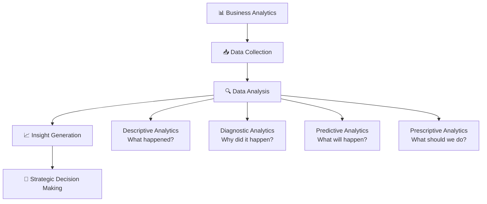

<p align="center">
  
</p>

<p align="center">
  
  
  
  
</p>

---

## 📋 Executive Summary

This repository contains **Business Analytics** coursework focused on applying analytical frameworks and data-driven methodologies to solve real-world business problems. The assignment explores core business analytics concepts including data interpretation, strategic decision-making, and business intelligence techniques.

Business Analytics bridges the gap between raw data and actionable business insights — enabling organizations to make informed, evidence-based decisions through statistical analysis, data visualization, and predictive modeling.

---

## 📑 Table of Contents

- [Key Features & Capabilities](#-key-features--capabilities)
- [Repository Overview](#-repository-overview)
- [Business Analytics Framework](#-business-analytics-framework)
- [Core Concepts Covered](#-core-concepts-covered)
- [Quickstart](#-quickstart)
- [Project Directory Layout](#-project-directory-layout)
- [Author & Contributions](#-author--contributions)

---

## ✨ Key Features & Capabilities

- **Business Analytics Assignment** — Structured analytical report exploring business intelligence methodologies
- **Data-Driven Decision Making** — Application of analytical frameworks to real-world business scenarios
- **Professional Documentation** — Well-structured Microsoft Word document with detailed analysis and findings

---

## 📖 Repository Overview

| File | Description | Format |
|------|------------|--------|
| `Assignment 3 BA.docx` | Business Analytics Assignment 3 — Analytical report | Microsoft Word (.docx) |

---

## 🏗️ Business Analytics Framework



---

## 📚 Core Concepts Covered

| Area | Description |
|------|------------|
| **Descriptive Analytics** | Summarizing historical data to understand past performance |
| **Data Interpretation** | Extracting meaningful insights from raw business data |
| **Decision Frameworks** | Structured approaches to business problem-solving |
| **Business Intelligence** | Transforming data into actionable strategies |

---

## 🚀 Quickstart

### Viewing the Assignment

```bash
# Clone the repository
git clone https://github.com/Chaturyathukivakam/Business-Analytics.git
cd Business-Analytics
```

Open `Assignment 3 BA.docx` using:
- **Microsoft Word** (recommended)
- **Google Docs** (upload to Google Drive)
- **LibreOffice Writer** (free alternative)

---

## 📂 Project Directory Layout

```
Business-Analytics/
├── Assignment 3 BA.docx    # Business Analytics Assignment 3 Report
└── README.md               # Project documentation
```

---

## 👤 Author & Contributions

**Chaturya Thukivakam**

[](https://github.com/Chaturyathukivakam)

Contributions, issues, and feature requests are welcome! Feel free to open a pull request.

---

<p align="center">
  
</p>
